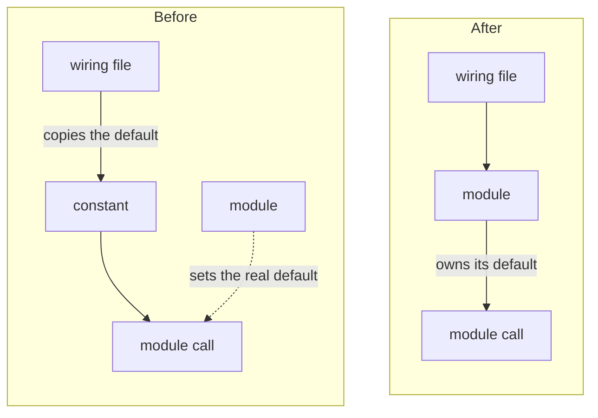

# Deepening

The architecture lens reads this file. The words and the tests come from Matt Pocock's `codebase-design` and `improve-codebase-architecture` skills (MIT licence, notice below).

## Words

- **Module**: anything with an interface and an implementation: a function, a class, a package.
- **Interface**: everything a caller must know to use the module correctly: the types, and also ordering rules, error modes and required config.
- **Depth**: how much behaviour a caller or a test gets per unit of interface it must learn. A deep module holds a lot of behaviour behind a small interface. A shallow module's interface is nearly as complex as its implementation.
- **Seam**: the place where a module's interface lives, where behaviour can change without editing the callers.
- **Adapter**: a concrete thing that fills a seam.
- **Locality**: change, bugs and knowledge sit in one module instead of spreading across its callers. A fix in one place fixes every caller.

## Tests

- **The deletion test.** Imagine deleting the module. If the complexity vanishes, the module was a pass-through. If the complexity reappears in its callers, the module does real work.
- **The interface is the test surface.** Callers and tests cross the same seam. A test that reaches past the interface means the module has the wrong shape.
- **One adapter means a hypothetical seam. Two adapters mean a real one.** Do not propose a seam unless something varies across it.

## Reading the history

The history shows where a rule is split. Run these at the head commit:

```bash
git log --oneline <base>..<head>
git log --stat --format='%h %s' <base>..<head>
git log --oneline -15 -- <file>
```

Report the counts as evidence, for example "7 of the 10 commits are fix commits, and 6 of those touch the stack file". A file that keeps changing in fix commits is where callers enforce a rule the module should hold.

## Dependency categories

Each candidate names how the deepened module is tested. Set `deps` to one of these:

1. `in-process`: pure computation or in-memory state. Test through the new interface directly.
2. `local-substitutable`: a local stand-in exists, such as an in-memory store or the infrastructure tool's mocks. Test with the stand-in.
3. `remote-owned`: your own service across a network. Define a port at the seam, with a production adapter and an in-memory adapter for tests.
4. `external`: a third-party service. Inject it as a port and test with a mock adapter.

## Candidate shape

A candidate is one finding with these fields, in the shape in `references/findings.md`:

- `id` `D1`, `D2` in strength order; `sev` `struct`; `cat` `architecture`.
- `title`: the change as a fact, such as "Each module builds its own alerts".
- `strength`, `scope` and `deps` as the lens and this file define them.
- `impact` and `fix` with the five labels; `reasoning` with the files and the history counts.
- `mermaid`: one `flowchart LR` with two subgraphs, Before and After, five to eight nodes each, joined by `Before ~~~ After` so they sit side by side. Mark the leaking edge in Before.



## Licence notice

```text
MIT License

Copyright (c) 2026 Matt Pocock

Permission is hereby granted, free of charge, to any person obtaining a copy
of this software and associated documentation files (the "Software"), to deal
in the Software without restriction, including without limitation the rights
to use, copy, modify, merge, publish, distribute, sublicense, and/or sell
copies of the Software, and to permit persons to whom the Software is
furnished to do so, subject to the following conditions:

The above copyright notice and this permission notice shall be included in all
copies or substantial portions of the Software.

THE SOFTWARE IS PROVIDED "AS IS", WITHOUT WARRANTY OF ANY KIND, EXPRESS OR
IMPLIED, INCLUDING BUT NOT LIMITED TO THE WARRANTIES OF MERCHANTABILITY,
FITNESS FOR A PARTICULAR PURPOSE AND NONINFRINGEMENT. IN NO EVENT SHALL THE
AUTHORS OR COPYRIGHT HOLDERS BE LIABLE FOR ANY CLAIM, DAMAGES OR OTHER
LIABILITY, WHETHER IN AN ACTION OF CONTRACT, TORT OR OTHERWISE, ARISING FROM,
OUT OF OR IN CONNECTION WITH THE SOFTWARE OR THE USE OR OTHER DEALINGS IN THE
SOFTWARE.
```
